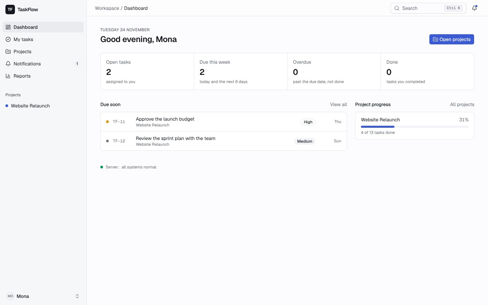
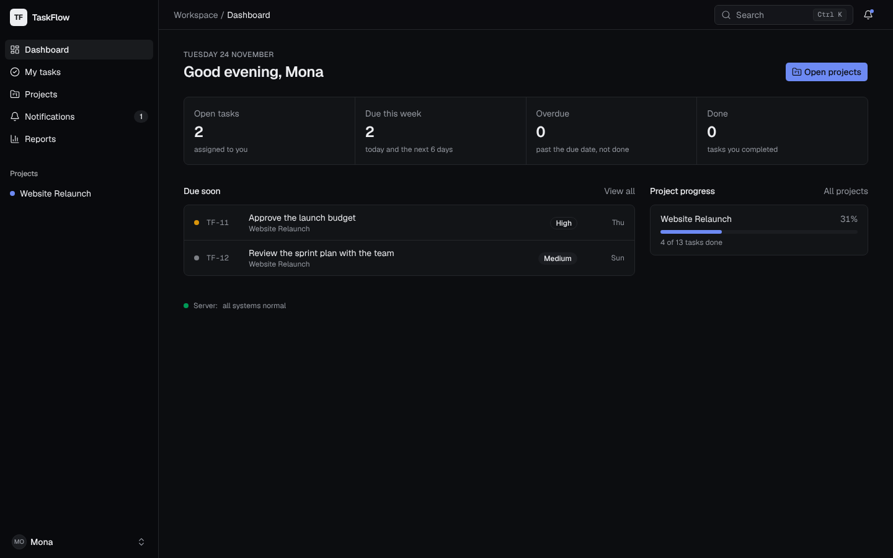
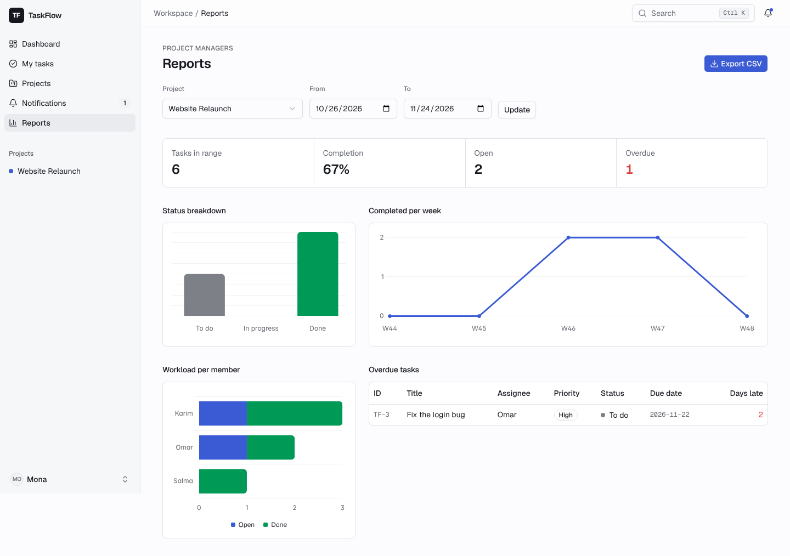
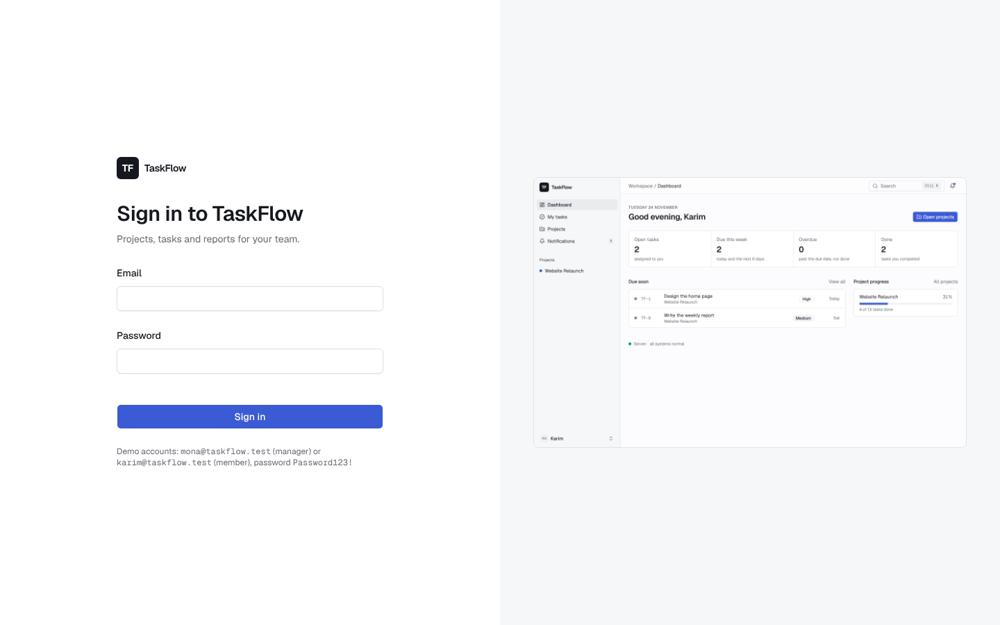

# TaskFlow – Task and Project Management System

Software Construction & Testing, Winter 2026 — Team: Tony, Fady, Ali, Mostafa, Youssef, Nazmy.

A web app where project managers create projects, assign tasks with due dates, and track progress, while team members update status, comment, get notified, and see recurring tasks appear automatically.

## Tech stack (and why)

| Part         | Tool                                        | Why                                                                                  |
| ------------ | ------------------------------------------- | ------------------------------------------------------------------------------------ |
| Language     | **JavaScript** (Node.js 22 LTS or newer)    | The labs teach JSDoc, `map`/`filter`/`reduce`, currying and `.bind()` in JavaScript  |
| Backend      | **Express 5**                               | Small, beginner-friendly web server                                                  |
| Database     | **SQLite** (built into Node: `node:sqlite`) | Nothing to install, one file, real SQL                                               |
| Frontend     | Plain **HTML + JavaScript** in `public/`    | No framework to learn; the Layered architecture stays the same                       |
| Design       | **Tailwind CSS 4** + **Basecoat** + Lucide  | One design system for every page, see [DESIGN.md](DESIGN.md)                         |
| Tests        | **Jest** + **Supertest** + **Playwright**   | Unit, integration and end-to-end tests (TDD), see [docs/TESTING.md](docs/TESTING.md) |
| Code quality | **ESLint** + **Prettier**                   | Checks code smells from Lab 2 and our layer rule; formats code automatically         |

## Run it (first time)

1. Install **Node.js 22 LTS** (or newer) from <https://nodejs.org>. Check with `node -v`.
2. Install **Git** and **VS Code** (VS Code will suggest the ESLint and Prettier extensions; accept them).
3. In a terminal:

```bash
git clone <our-repo-url>
cd taskflow
npm install
npm run seed
npm start
```

4. Open <http://localhost:3000> and log in as `mona@taskflow.test` (manager) or `karim@taskflow.test` (member). Every seeded user has the password `Password123!`. You land on the dashboard.

No build step is needed to run the app: the built stylesheet and icons in `public/css` and `public/vendor` are committed. Run `npm run build` only after changing `src/styles/app.css` or updating the design packages. 5. Follow **[docs/DEMO.md](docs/DEMO.md)** for the full Milestone 2 walkthrough and the Postman collection. 6. Open <http://localhost:3000/api-docs> to browse and try every endpoint in **Swagger UI**.

## Screenshots

| Dashboard (light)                                               | Dashboard (dark)                                              |
| --------------------------------------------------------------- | ------------------------------------------------------------- |
|  |  |
| **Reports (FR7)**                                               | **Sign in**                                                   |
|              |              |

The living style guide with every component is at <http://localhost:3000/styleguide.html>.

## Deployment

`render.yaml` deploys the app on Render's free plan (render.com → New → Blueprint → this repository). The server loads the demo data on first start (`SEED_ON_EMPTY=true`).

Preparing for an evaluation? Read **[docs/ARCHITECTURE.md](docs/ARCHITECTURE.md)** (design → code), **[docs/DESIGN_PATTERNS.md](docs/DESIGN_PATTERNS.md)**, **[docs/TESTING.md](docs/TESTING.md)**, **[docs/USER_STORIES.md](docs/USER_STORIES.md)** and **[docs/DEMO.md](docs/DEMO.md)** (demo script). Libraries we build on are credited in **[CREDITS.md](CREDITS.md)**.

## Everyday commands

| Command                 | What it does                                                                               |
| ----------------------- | ------------------------------------------------------------------------------------------ |
| `npm run seed`          | Deletes all data and loads the demo users, project and tasks                               |
| `npm run dev`           | Starts the server and restarts it every time you save a file                               |
| `npm test`              | Runs all tests                                                                             |
| `npm run test:coverage` | Runs tests and shows how much code they cover                                              |
| `npm run lint`          | Checks for code smells and layer-rule violations                                           |
| `npm run lint:fix`      | Fixes what can be fixed automatically                                                      |
| `npm run format`        | Formats every file the same way                                                            |
| `npm run test:e2e`      | End-to-end tests in a real browser (first time: `npx playwright install chromium`)         |
| `npm run test:api`      | Runs the Postman collection against a seeded server (Newman)                               |
| `npm run trace`         | Regenerates the user story → test matrix in `docs/TRACEABILITY.md`                         |
| `npm run build`         | Rebuilds `public/css/app.css` and copies icons, fonts and scripts                          |
| `npm run check`         | lint + format check + tests with the coverage gate. **Run this before every pull request** |

## Project structure (Layered architecture from Milestone 1)

```
public/                 Frontend: HTML pages, js/ (api.js = the only place that calls the backend,
                        layout.js = the app shell, ui.js = shared UI helpers), css/ and vendor/ (built)
src/
  presentation/         TOP: controllers/, routes/, middleware/, scheduler/
  business/             MIDDLE: services/, rules/, events/, errors/
  data-access/          BOTTOM: database/ (connection, schema.sql, seed), repositories/
  domain/               Plain models used by every layer (Task, User, ...)
  container.js          Creates every object and connects them (dependency injection)
  app.js                Builds the Express app
  server.js             Starts it (npm start)
  styles/app.css        Design tokens + Tailwind/Basecoat entry (npm run build → public/css/app.css)
tests/
  unit/                 One test file per service / rule / repository
  integration/          Tests through the real app and database
  e2e/                  Full user journeys in a real browser (Playwright)
scripts/                Asset build, E2E server, API tests, traceability matrix
```

**The one rule:** each layer only talks to the layer directly below it.
`presentation → business → data-access`. A controller never calls a repository. ESLint blocks it automatically.

Read **[CONVENTIONS.md](CONVENTIONS.md)** before writing your first line of code.
